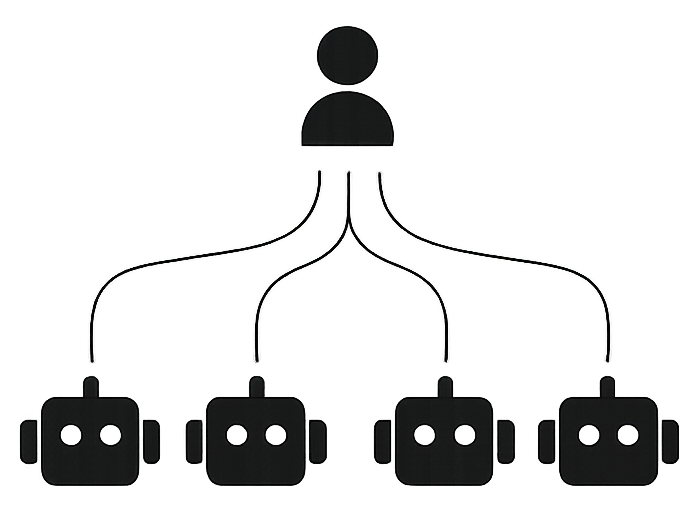

<p align="center">
  <picture>
    <source media="(prefers-color-scheme: dark)" srcset="./pi-symbol-dark.svg" />
    <source media="(prefers-color-scheme: light)" srcset="./pi-symbol-light.svg" />
    
  </picture>
</p>

<p align="center"><b>Pi Dash -- AIエージェントオーケストレーションプラットフォーム</b></p>

<p align="center">
    <a href="https://pidash.airepublic.com"><b>Live</b></a> •
    <a href="https://airepublic.com/"><b>Website</b></a> •
    <a href="https://airepublic.com/docs"><b>Documentation</b></a> •
    <a href="https://airepublic.com/"><b>Community</b></a> •
    <a href="https://x.com/ai_republic"><b>X</b></a>
</p>

<p align="center">
    <a href="./README.md"><b>English</b></a> •
    <a href="./README.zh-CN.md"><b>简体中文</b></a> •
    <b>日本語</b> •
    <a href="./README.pt-BR.md"><b>Português (BR)</b></a> •
    <a href="./README.es.md"><b>Español</b></a> •
    <a href="./README.ko.md"><b>한국어</b></a>
</p>

Pi Dash は、**As Coding（非同期バイブコーディング）** のために構築されたオープンソースの AI エージェントオーケストレーションプラットフォームです。これは、何を構築すべきかを定義すれば、コーディングエージェントがバックグラウンドで実装を処理してくれるワークフローです。エージェントの実行を見守ったり、スクロールするターミナルを眺めたりする代わりに、Pi Dash を使えば本当に重要な作業、すなわちタスクのスコープ設定、結果のレビュー、プロダクトの出荷に集中できます。

**[pidash.airepublic.com](https://pidash.airepublic.com)** で今すぐお試しください。インストールは不要です。

> Pi Dash は日々進化しています。皆さまからの提案、アイデア、バグ報告は私たちにとって大きな助けとなります。お気軽に [GitHub ディスカッション](https://github.com/The-AI-Republic/pi-dash/discussions)を開いたり、[Issue を起票](https://github.com/The-AI-Republic/pi-dash/issues)したりしてください。私たちはすべてに目を通し、ほとんどに返信しています。

## 🌟 アーキテクチャ

Pi Dash は 3 つの主要コンポーネントで構成されています。

<p align="center">
  <picture>
    <source media="(prefers-color-scheme: dark)" srcset="./images/pidash_diagram_white.png" />
    <source media="(prefers-color-scheme: light)" srcset="./images/pidash_diagram_black.png" />
    
  </picture>
</p>

### Pi Dash Platform

プロジェクトを管理し、タスクを定義し、エージェントの進捗を監視するための Web ベースのオーケストレーションハブです。作業項目を作成し、サイクルやモジュールに整理し、エージェントの出力をレビューし、分析を追跡する。これらすべてを単一のダッシュボードから行えます。ここが、ターミナルを眺める代わりに時間を費やす場所です。

### Pi Dash CLI & Runner Daemon

開発マシン上で動作するローカルのコマンドラインツールとバックグラウンドデーモンです。CLI は Pi Dash プラットフォームに接続し、割り当てられたタスクを受け取り、設定された AI エージェントにディスパッチし、結果を報告します。runner デーモンはこのループを継続的に回し続けるため、各タスクを手動でトリガーする必要はありません。

### AI Agent（ユーザー提供）

Pi Dash はエージェント非依存であり、お好みのコーディングエージェントを持ち込めます。現在、runner は **Claude Code** と **Codex** をファーストクラスでサポートしています。ディスパッチ層は、オーケストレーションモデルを変更することなく追加のエージェントを組み込めるように設計されています。runner が呼び出すエージェントを設定すれば、残りは Pi Dash が処理します。

## 🚀 インストール

> **Pi Dash Cloud** が **[pidash.airepublic.com](https://pidash.airepublic.com)** で公開されました。サインアップすれば、自身のインフラを運用することなく始められます。セルフホストをご希望ですか？以下の手順に従ってください。

### 1. Pi Dash Platform（セルフホスト）

現在のプラットフォームは Rust API（`rust-api/`）と新しいフロントエンド（`apps/web_new/`）、リアルタイムサーバー（`apps/live/`）です。[英語版のインストールガイド](./README.md#-installation)を参照してください — このセクションの翻訳は準備中です。
### 2. Pi Dash CLI & Runner Daemon

エージェントにタスクを受け取らせて実行させたい任意のマシンに CLI をインストールします。現在サポートされているプラットフォーム:

- **macOS** — Apple Silicon (arm64)
- **macOS** — Intel (x86_64)
- **Linux** — arm64 および x86_64
- **Windows** — x86_64

macOS および Linux では、開発マシンのターミナルで以下のコマンドを実行します:

```bash
curl --proto '=https' --tlsv1.2 -LsSf \
  https://github.com/The-AI-Republic/pi-dash/releases/latest/download/pidash-installer.sh | sh
```

Windows では、MSI インストーラーをダウンロードして実行します:

<https://github.com/The-AI-Republic/pi-dash/releases/latest/download/pidash-x86_64-pc-windows-msvc.msi>

特定のバージョンに固定する（またはプレリリースをインストールする）には、`latest` をタグに置き換えてください。例: `.../releases/download/pidash-v0.1.4/pidash-installer.sh`。プレリリースは `/latest/` から除外されているため、上記のワンライナーは常に最新の安定版リリースを提供します。完全な固定手順（ラッパー、素のインストーラー、Windows バリアント）は [`runner/README.md`](./runner/README.md#installing-a-specific-version-pinning--prereleases) に記載されています。

次に、マシンを認証して runner を登録します。標準的なフローは 2 つのコマンドです:

```bash
# 1. ブラウザベースの device-code ログイン（`gh auth login` / `stripe login` のような形式）。
#    CLI トークンを ~/.config/pidash/config.toml に保存します。
pidash login --url https://your-pidash-instance.com

# 2. このホストを runner として登録します。手順 1 のトークンを使用するため、
#    enrollment-token の貼り付けは不要です。最初の runner では OS サービス
#    （Linux では systemd ユーザーユニット、macOS では launchd エージェント、
#    Windows ではユーザーごとのスケジュールされたタスク）をインストールし、
#    デーモンを起動します。
pidash runner add --project <project-id>
```

`pidash login`（`pidash auth login` のエイリアス）は、まだ runner が存在しない場合にインラインで runner の追加を促すため、まっさらな開発用ラップトップを単一のコマンドでオンボーディングできます。後から `pidash runner add --project <other-project-id>` でさらに runner を追加できます。

runner デーモンはバックグラウンドで動作し、割り当てられたタスクをポーリングし、AI エージェントにディスパッチし、結果をプラットフォームに報告します。

便利なコマンド:

| コマンド        | 説明                                                                                                 |
| --------------- | ---------------------------------------------------------------------------------------------------- |
| `pidash status` | サービスとデーモンのステータスを表示する                                                             |
| `pidash tui`    | デーモンを監視するためのインタラクティブなターミナル UI を開く                                       |
| `pidash doctor` | プリフライトチェックを実行する（エージェントのインストール、git の設定、プラットフォームへの到達性） |
| `pidash stop`   | デーモンを停止する                                                                                   |

利用可能なすべてのコマンドについては `pidash --help` を参照してください。

### 3. AI Agent（ユーザー提供）

Pi Dash は AI エージェントを同梱していません。お好みのものを持ち込んでください。選択したエージェントの CLI が、Pi Dash CLI を実行するマシン上にインストールされ、アクセス可能であることを確認してください。runner は現在、2 種類のエージェントを標準でサポートしています:

- **Claude Code** — [`claude`](https://docs.anthropic.com/en/docs/claude-code) をインストールし、`claude --version` が動作することを確認してください。
- **Codex** — [`codex`](https://github.com/openai/codex) をインストールし、`codex --version` が動作することを確認してください。

`pidash doctor` は、本番稼働前に、設定されたエージェントが `PATH` 上にあること、およびクラウドに到達可能であることを検証します。

### 4. コーディングエージェント向け Pi Dash スキル（オプション）

[`skill/`](skill/) は、ポータブルなエージェントスキルをパッケージ化したものです。これにより、Claude Code や Codex が `pidash` CLI を介して、コーディングセッションから直接 Pi Dash の Issue を作成、一覧表示、移動、検査できます。

```bash
npx @airepublic/pidash-skill-installer           # Claude Code、Codex、またはその両方にインストールします
```

インストーラーはターゲット（デフォルト: すべて）を尋ねます。スキルは npm パッケージに同梱されているため、クローンは不要です。プロンプトをスキップするには `--all`、`--claude-code`、または `--codex` を渡してください。

Codex ユーザーは、Codex セッション内から組み込みの `$skill-installer` を介してインストールすることもできます。環境変数のオーバーライド（`CLAUDE_HOME` / `CODEX_HOME`）、クローンベースのインストール方法、その他の代替手段については [skill README](skill/README.md) を参照してください。

## ⚙️ 使用技術

[](https://reactrouter.com/)
[](https://www.rust-lang.org/)
[](https://nodejs.org/en)

## 📝 ドキュメント

機能、セットアップ、使用方法について学ぶには、[Pi Dash ドキュメント](https://airepublic.com/docs)をご覧ください。

## ❤️ コミュニティ

[GitHub Discussions](https://github.com/The-AI-Republic/pi-dash/discussions) で会話に参加し、X で [@ai_republic](https://x.com/ai_republic) をフォローするか、最新情報については [airepublic.com](https://airepublic.com/) をご覧ください。私たちはすべてのコミュニティチャネルで[行動規範](./CODE_OF_CONDUCT.md)に従っています。

質問、バグ報告、ディスカッションへの参加、アイデアの共有、機能リクエスト、プロジェクトの紹介など、お気軽にどうぞ。皆さまからのご連絡をお待ちしています！

## 🛡️ セキュリティ

Pi Dash にセキュリティ脆弱性を発見した場合は、公開 Issue を作成するのではなく、責任を持って報告してください。詳細は [SECURITY.md](./SECURITY.md) を参照してください。

セキュリティ上の問題を開示するには、[privacy_security@airepublic.com](mailto:privacy_security@airepublic.com) までメールでご連絡ください。

## 🤝 コントリビューション

Pi Dash には多くの貢献方法があります:

- [バグ](https://github.com/The-AI-Republic/pi-dash/issues/new)を報告したり、機能リクエストを送信したりする。
- ドキュメントをレビューし、それを改善するためのプルリクエストを送信する。誤字の修正でも新しいコンテンツの追加でも構いません。
- [人気の機能リクエスト](https://github.com/The-AI-Republic/pi-dash/issues)に賛成票を投じて支持を示す。

プルリクエスト送信のプロセスの詳細については、[CONTRIBUTING.md](./CONTRIBUTING.md) をお読みください。

### 皆さまなしには成し得ませんでした。

<a href="https://github.com/The-AI-Republic/pi-dash/graphs/contributors">
  コミュニティのコントリビューターの皆さま
</a>

## 謝辞

Pi Dash は、オープンソースのプロジェクト管理ツールである [Plane](https://github.com/makeplane/plane) の上に構築されています。Pi Dash を可能にする基盤を築いてくれた Plane チームとそのコントリビューターの皆さまに感謝します。

## ライセンス

本プロジェクトは [GNU Affero General Public License v3.0](./LICENSE.txt) の下でライセンスされています。
