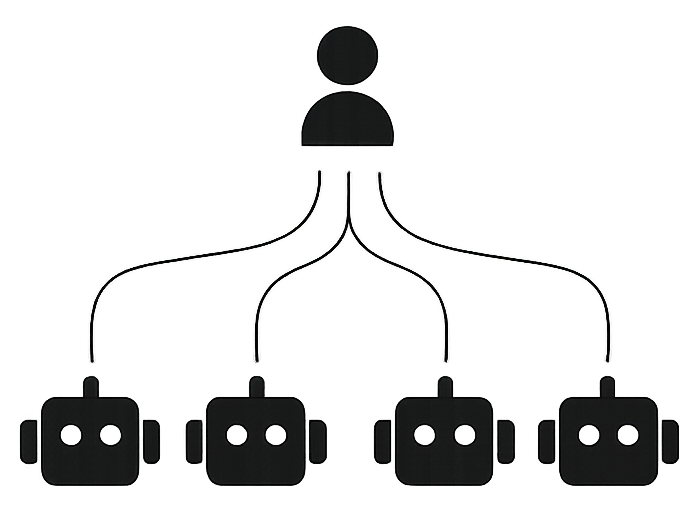

<p align="center">
  <picture>
    <source media="(prefers-color-scheme: dark)" srcset="./pi-symbol-dark.svg" />
    <source media="(prefers-color-scheme: light)" srcset="./pi-symbol-light.svg" />
    
  </picture>
</p>

<p align="center"><b>Pi Dash -- Plataforma de Orquestração de Agentes de IA</b></p>

<p align="center">
    <a href="https://pidash.airepublic.com"><b>Demonstração</b></a> •
    <a href="https://airepublic.com/"><b>Website</b></a> •
    <a href="https://airepublic.com/docs"><b>Documentação</b></a> •
    <a href="https://airepublic.com/"><b>Comunidade</b></a> •
    <a href="https://x.com/ai_republic"><b>X</b></a>
</p>

<p align="center">
    <a href="./README.md"><b>English</b></a> •
    <a href="./README.zh-CN.md"><b>简体中文</b></a> •
    <a href="./README.ja.md"><b>日本語</b></a> •
    <b>Português (BR)</b> •
    <a href="./README.es.md"><b>Español</b></a> •
    <a href="./README.ko.md"><b>한국어</b></a>
</p>

O Pi Dash é uma plataforma open-source de orquestração de agentes de IA criada para o **As Coding (vibe coding assíncrono)** — um fluxo de trabalho em que você define o que precisa ser construído, e os agentes de codificação cuidam da implementação em segundo plano. Em vez de ficar supervisionando as execuções dos agentes e acompanhando terminais rolando na tela, o Pi Dash permite que você foque no trabalho que realmente importa: definir o escopo das tarefas, revisar resultados e entregar produtos.

Experimente agora em **[pidash.airepublic.com](https://pidash.airepublic.com)** — sem necessidade de instalação.

> O Pi Dash evolui a cada dia. Suas sugestões, ideias e bugs reportados nos ajudam imensamente. Não hesite em abrir uma [discussão no GitHub](https://github.com/The-AI-Republic/pi-dash/discussions) ou [criar uma issue](https://github.com/The-AI-Republic/pi-dash/issues). Lemos tudo e respondemos à maioria.

## 🌟 Arquitetura

O Pi Dash é composto por três componentes principais:

<p align="center">
  <picture>
    <source media="(prefers-color-scheme: dark)" srcset="./images/pidash_diagram_white.png" />
    <source media="(prefers-color-scheme: light)" srcset="./images/pidash_diagram_black.png" />
    
  </picture>
</p>

### Plataforma Pi Dash

O hub de orquestração baseado na web onde você gerencia projetos, define tarefas e monitora o progresso dos agentes. Crie itens de trabalho, organize-os em ciclos e módulos, revise a saída dos agentes e acompanhe análises — tudo a partir de um único dashboard. É aqui que você passa o seu tempo, em vez de ficar observando terminais.

### Pi Dash CLI e Runner Daemon

Uma ferramenta de linha de comando local e um daemon em segundo plano que rodam na sua máquina de desenvolvimento. A CLI se conecta à plataforma Pi Dash, captura as tarefas atribuídas, as despacha para o agente de IA configurado e reporta os resultados de volta. O runner daemon mantém esse ciclo em funcionamento continuamente, para que você não precise acionar cada tarefa manualmente.

### Agente de IA (fornecido pelo usuário)

O Pi Dash é agnóstico em relação a agentes — traga o seu próprio agente de codificação. Atualmente, o runner oferece suporte de primeira classe ao **Claude Code** e ao **Codex**; a camada de despacho foi projetada de modo que agentes adicionais possam ser integrados sem alterar o modelo de orquestração. Você configura qual agente o runner invoca; o Pi Dash cuida do resto.

## 🚀 Instalação

> O **Pi Dash Cloud** já está disponível em **[pidash.airepublic.com](https://pidash.airepublic.com)** — cadastre-se para começar sem precisar manter sua própria infraestrutura. Prefere fazer o self-host? Siga os passos abaixo.

### 1. Plataforma Pi Dash (self-hosted)

A plataforma atual é a API em Rust (`rust-api/`) com o novo frontend (`apps/web_new/`) e o servidor de tempo real (`apps/live/`). Siga o [guia de instalação em inglês](./README.md#-installation) — a tradução desta seção está pendente.
### 2. Pi Dash CLI e Runner Daemon

Instale a CLI em qualquer máquina onde você queira que os agentes capturem e executem tarefas. Plataformas atualmente suportadas:

- **macOS** — Apple Silicon (arm64)
- **macOS** — Intel (x86_64)
- **Linux** — arm64 e x86_64
- **Windows** — x86_64

No macOS e no Linux, execute o seguinte comando no terminal da sua máquina de desenvolvimento:

```bash
curl --proto '=https' --tlsv1.2 -LsSf \
  https://github.com/The-AI-Republic/pi-dash/releases/latest/download/pidash-installer.sh | sh
```

No Windows, baixe e execute o instalador MSI:

<https://github.com/The-AI-Republic/pi-dash/releases/latest/download/pidash-x86_64-pc-windows-msvc.msi>

Para fixar uma versão específica (ou instalar uma prerelease), troque `latest` pela tag, por exemplo `.../releases/download/pidash-v0.1.4/pidash-installer.sh`. As prereleases são excluídas de `/latest/`, então os comandos de uma linha acima sempre servem a última versão estável. As receitas completas de fixação de versão — wrapper, instalador puro, variantes do Windows — estão em [`runner/README.md`](./runner/README.md#installing-a-specific-version-pinning--prereleases).

Em seguida, autentique a máquina e registre um runner. O fluxo padrão consiste em dois comandos:

```bash
# 1. Login por device-code baseado no navegador (como `gh auth login` / `stripe login`).
#    Armazena um token da CLI em ~/.config/pidash/config.toml.
pidash login --url https://your-pidash-instance.com

# 2. Registra este host como um runner. Usa o token do passo 1 — sem
#    necessidade de colar um enrollment-token. No primeiro runner, instala o
#    serviço do SO (systemd user unit no Linux, launchd agent no macOS, ou uma
#    tarefa agendada por usuário no Windows) e inicia o daemon.
pidash runner add --project <project-id>
```

O `pidash login` (alias de `pidash auth login`) solicita a adição de um runner de forma integrada quando ainda não há nenhum runner, de modo que um laptop de desenvolvimento novo pode ser configurado com um único comando. Adicione mais runners depois com `pidash runner add --project <other-project-id>`.

O runner daemon roda em segundo plano, consulta as tarefas atribuídas, as despacha para o seu agente de IA e reporta os resultados de volta à plataforma.

Comandos úteis:

| Comando         | Descrição                                                                               |
| --------------- | --------------------------------------------------------------------------------------- |
| `pidash status` | Exibe o status do serviço e do daemon                                                   |
| `pidash tui`    | Abre uma UI de terminal interativa para monitorar o daemon                              |
| `pidash doctor` | Executa verificações iniciais (agente instalado, git configurado, plataforma acessível) |
| `pidash stop`   | Para o daemon                                                                           |

Consulte `pidash --help` para todos os comandos disponíveis.

### 3. Agente de IA (fornecido pelo usuário)

O Pi Dash não inclui um agente de IA — você traz o seu próprio. Certifique-se de que a CLI do agente escolhido esteja instalada e acessível na máquina que executa a CLI do Pi Dash. O runner atualmente suporta dois tipos de agente de imediato:

- **Claude Code** — instale o [`claude`](https://docs.anthropic.com/en/docs/claude-code) e certifique-se de que `claude --version` funcione.
- **Codex** — instale o [`codex`](https://github.com/openai/codex) e certifique-se de que `codex --version` funcione.

O `pidash doctor` verifica se o agente configurado está no `PATH` e se a nuvem está acessível antes de você entrar em operação.

### 4. Skill do Pi Dash para o agente de codificação (opcional)

O [`skill/`](skill/) empacota uma skill de agente portátil para que o Claude Code ou o Codex possam criar, listar, mover e inspecionar issues do Pi Dash diretamente de uma sessão de codificação por meio da CLI `pidash`.

```bash
npx @airepublic/pidash-skill-installer           # instala no Claude Code, no Codex, ou em ambos
```

O instalador solicita um alvo (padrão: todos) — a skill vem incluída no pacote npm, sem necessidade de clone. Passe `--all`, `--claude-code` ou `--codex` para pular a solicitação.

Usuários do Codex também podem instalar por meio do `$skill-installer` integrado, de dentro de uma sessão do Codex. Consulte o [README da skill](skill/README.md) para sobrescritas de variáveis de ambiente (`CLAUDE_HOME` / `CODEX_HOME`), o caminho de instalação baseado em clone e outras alternativas.

## ⚙️ Construído com

[](https://reactrouter.com/)
[](https://www.rust-lang.org/)
[](https://nodejs.org/en)

## 📝 Documentação

Explore a [documentação do Pi Dash](https://airepublic.com/docs) para saber mais sobre recursos, configuração e uso.

## ❤️ Comunidade

Participe da conversa no [GitHub Discussions](https://github.com/The-AI-Republic/pi-dash/discussions), siga [@ai_republic](https://x.com/ai_republic) no X, ou visite [airepublic.com](https://airepublic.com/) para novidades. Seguimos um [Código de conduta](./CODE_OF_CONDUCT.md) em todos os nossos canais da comunidade.

Sinta-se à vontade para fazer perguntas, reportar bugs, participar de discussões, compartilhar ideias, solicitar recursos ou mostrar seus projetos. Adoraríamos saber de você!

## 🛡️ Segurança

Se você descobrir uma vulnerabilidade de segurança no Pi Dash, por favor reporte-a de forma responsável em vez de abrir uma issue pública. Consulte [SECURITY.md](./SECURITY.md) para mais informações.

Para divulgar quaisquer problemas de segurança, por favor nos envie um e-mail para [privacy_security@airepublic.com](mailto:privacy_security@airepublic.com).

## 🤝 Contribuindo

Há muitas formas de contribuir com o Pi Dash:

- Reporte [bugs](https://github.com/The-AI-Republic/pi-dash/issues/new) ou envie solicitações de recursos.
- Revise a documentação e envie pull requests para melhorá-la — seja corrigindo erros de digitação ou adicionando novo conteúdo.
- Demonstre seu apoio votando em [solicitações de recursos populares](https://github.com/The-AI-Republic/pi-dash/issues).

Por favor, leia o [CONTRIBUTING.md](./CONTRIBUTING.md) para detalhes sobre o processo de envio de pull requests.

### Não teríamos conseguido sem você.

<a href="https://github.com/The-AI-Republic/pi-dash/graphs/contributors">
  Nossos contribuidores da comunidade
</a>

## Agradecimentos

O Pi Dash é construído sobre o [Plane](https://github.com/makeplane/plane), uma ferramenta open-source de gerenciamento de projetos. Somos gratos à equipe do Plane e aos seus contribuidores por estabelecerem a base que tornou o Pi Dash possível.

## Licença

Este projeto está licenciado sob a [GNU Affero General Public License v3.0](./LICENSE.txt).
