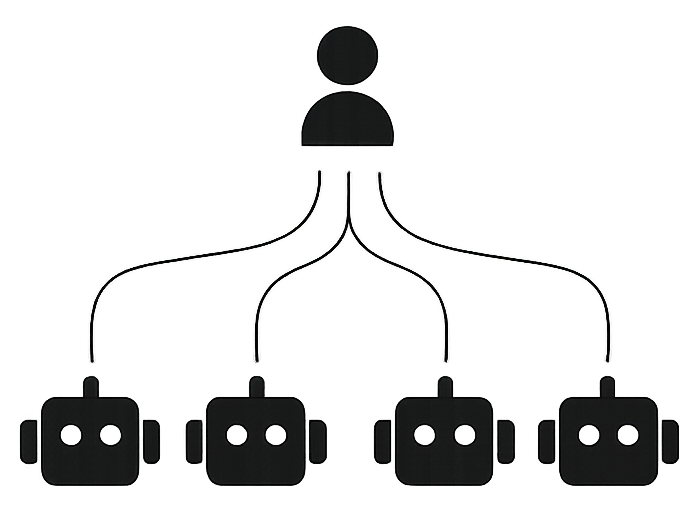

<p align="center">
  <picture>
    <source media="(prefers-color-scheme: dark)" srcset="./pi-symbol-dark.svg" />
    <source media="(prefers-color-scheme: light)" srcset="./pi-symbol-light.svg" />
    
  </picture>
</p>

<p align="center"><b>Pi Dash —— AI 智能体编排平台</b></p>

<p align="center">
    <a href="https://pidash.airepublic.com"><b>在线体验</b></a> •
    <a href="https://airepublic.com/"><b>官网</b></a> •
    <a href="https://airepublic.com/docs"><b>文档</b></a> •
    <a href="https://airepublic.com/"><b>社区</b></a> •
    <a href="https://x.com/ai_republic"><b>X</b></a>
</p>

<p align="center">
    <a href="./README.md"><b>English</b></a> •
    <b>简体中文</b> •
    <a href="./README.ja.md"><b>日本語</b></a> •
    <a href="./README.pt-BR.md"><b>Português (BR)</b></a> •
    <a href="./README.es.md"><b>Español</b></a> •
    <a href="./README.ko.md"><b>한국어</b></a>
</p>

Pi Dash 是一个开源的 AI 智能体编排平台，专为 **As Coding（异步氛围编程）** 打造——在这种工作流中，你只需定义需要构建的内容，编码智能体便会在后台完成具体实现。无需再盯着智能体运行、看着终端不断滚动，Pi Dash 让你专注于真正重要的工作：规划任务、审阅结果、交付产品。

立即在 **[pidash.airepublic.com](https://pidash.airepublic.com)** 试用——无需安装。

> Pi Dash 每天都在不断进化。你的建议、想法和反馈的 bug 对我们帮助极大。欢迎随时发起 [GitHub 讨论](https://github.com/The-AI-Republic/pi-dash/discussions) 或 [提交 issue](https://github.com/The-AI-Republic/pi-dash/issues)。我们会阅读每一条反馈，并回复其中的绝大多数。

## 🌟 架构

Pi Dash 由三大核心组件构成：

<p align="center">
  <picture>
    <source media="(prefers-color-scheme: dark)" srcset="./images/pidash_diagram_white.png" />
    <source media="(prefers-color-scheme: light)" srcset="./images/pidash_diagram_black.png" />
    
  </picture>
</p>

### Pi Dash 平台

基于 Web 的编排中枢，用于管理项目、定义任务、监控智能体进度。在这里创建工作项，将它们组织成周期（cycle）和模块（module），审阅智能体的输出，并跟踪分析数据——一切都在同一个仪表盘中完成。你把时间花在这里，而不是盯着终端。

### Pi Dash CLI 与 Runner 守护进程

运行在你的开发机器上的本地命令行工具和后台守护进程。CLI 连接到 Pi Dash 平台，领取分配的任务，将其派发给你配置的 AI 智能体，并把结果回报。Runner 守护进程持续保持这一循环运转，因此你无需手动触发每个任务。

### AI 智能体（由用户提供）

Pi Dash 与智能体无关——你可以使用自己的编码智能体。目前 Runner 已对 **Claude Code** 和 **Codex** 提供一流支持；派发层的设计使得在不改变编排模型的前提下即可接入更多智能体。你只需配置 Runner 调用哪个智能体，其余的交给 Pi Dash 处理。

## 🚀 安装

> **Pi Dash Cloud** 现已上线，地址为 **[pidash.airepublic.com](https://pidash.airepublic.com)**——注册即可上手，无需自行运维基础设施。更倾向于自托管？请按照下面的步骤操作。

### 1. Pi Dash 平台（自托管）

当前平台为 Rust API（`rust-api/`）搭配新版前端（`apps/web_new/`）与实时服务器（`apps/live/`）。请参阅[英文版安装指南](./README.md#-installation)——本节翻译即将更新。
### 2. Pi Dash CLI 与 Runner 守护进程

在任何你希望智能体领取并执行任务的机器上安装 CLI。目前支持的平台：

- **macOS** —— Apple Silicon（arm64）
- **macOS** —— Intel（x86_64）
- **Linux** —— arm64 和 x86_64
- **Windows** —— x86_64

在 macOS 和 Linux 上，在开发机器的终端中运行以下命令：

```bash
curl --proto '=https' --tlsv1.2 -LsSf \
  https://github.com/The-AI-Republic/pi-dash/releases/latest/download/pidash-installer.sh | sh
```

在 Windows 上，下载并运行 MSI 安装程序：

<https://github.com/The-AI-Republic/pi-dash/releases/latest/download/pidash-x86_64-pc-windows-msvc.msi>

如需固定到特定版本（或安装预发布版本），将 `latest` 替换为对应标签即可，例如 `.../releases/download/pidash-v0.1.4/pidash-installer.sh`。预发布版本不会包含在 `/latest/` 中，因此上面的一行命令始终提供最近的稳定版本。完整的版本固定方法——封装脚本、裸安装程序、Windows 各变体——详见 [`runner/README.md`](./runner/README.md#installing-a-specific-version-pinning--prereleases)。

随后对该机器进行认证并注册一个 runner。标准流程为两条命令：

```bash
# 1. 基于浏览器的设备码登录（类似 `gh auth login` / `stripe login`）。
#    会在 ~/.config/pidash/config.toml 中存储 CLI 令牌。
pidash login --url https://your-pidash-instance.com

# 2. 将本主机注册为 runner。使用步骤 1 中的令牌——无需
#    粘贴 enrollment-token。在第一个 runner 上，会安装操作系统
#    服务（Linux 上为 systemd 用户单元，macOS 上为 launchd agent，Windows
#    上为按用户的计划任务）并启动守护进程。
pidash runner add --project <project-id>
```

当尚不存在 runner 时，`pidash login`（`pidash auth login` 的别名）会内联提示添加一个 runner，因此一台全新的开发笔记本仅需一条命令即可完成上线。之后可使用 `pidash runner add --project <other-project-id>` 添加更多 runner。

Runner 守护进程在后台运行，轮询分配的任务，将其派发给你的 AI 智能体，并把结果回报给平台。

常用命令：

| 命令            | 说明                                                       |
| --------------- | ---------------------------------------------------------- |
| `pidash status` | 打印服务和守护进程状态                                     |
| `pidash tui`    | 打开交互式终端 UI 以监控守护进程                           |
| `pidash doctor` | 运行预检（智能体是否已安装、git 是否已配置、平台是否可达） |
| `pidash stop`   | 停止守护进程                                               |

运行 `pidash --help` 查看所有可用命令。

### 3. AI 智能体（由用户提供）

Pi Dash 不附带 AI 智能体——你需要自备。请确保你所选的智能体 CLI 已安装，并在运行 Pi Dash CLI 的机器上可访问。Runner 目前开箱支持两类智能体：

- **Claude Code** —— 安装 [`claude`](https://docs.anthropic.com/en/docs/claude-code)，并确保 `claude --version` 可正常运行。
- **Codex** —— 安装 [`codex`](https://github.com/openai/codex)，并确保 `codex --version` 可正常运行。

在你正式上线之前，`pidash doctor` 会验证所配置的智能体是否在 `PATH` 中，以及云端是否可达。

### 4. 面向编码智能体的 Pi Dash skill（可选）

[`skill/`](skill/) 将一个可移植的智能体 skill 打包在一起，使 Claude Code 或 Codex 能够通过 `pidash` CLI 直接在编码会话中创建、列出、移动和查看 Pi Dash issue。

```bash
npx @airepublic/pidash-skill-installer           # 安装到 Claude Code、Codex 或两者
```

安装程序会提示选择目标（默认：全部）；skill 已随 npm 包一同发布，无需克隆。传入 `--all`、`--claude-code` 或 `--codex` 可跳过提示。

Codex 用户也可以在 Codex 会话内通过内置的 `$skill-installer` 进行安装。关于环境变量覆盖（`CLAUDE_HOME` / `CODEX_HOME`）、基于克隆的安装方式以及其他替代方案，详见 [skill README](skill/README.md)。

## ⚙️ 技术栈

[](https://reactrouter.com/)
[](https://www.rust-lang.org/)
[](https://nodejs.org/en)

## 📝 文档

浏览 [Pi Dash 文档](https://airepublic.com/docs) 以了解功能、配置和使用方法。

## ❤️ 社区

加入 [GitHub Discussions](https://github.com/The-AI-Republic/pi-dash/discussions) 的讨论，在 X 上关注 [@ai_republic](https://x.com/ai_republic)，或访问 [airepublic.com](https://airepublic.com/) 获取最新动态。我们在所有社区渠道中均遵循 [行为准则](./CODE_OF_CONDUCT.md)。

欢迎提问、反馈 bug、参与讨论、分享想法、请求新功能，或展示你的项目。我们非常期待你的声音！

## 🛡️ 安全

如果你在 Pi Dash 中发现了安全漏洞，请负责任地报告，而不要公开提交 issue。更多信息详见 [SECURITY.md](./SECURITY.md)。

如需披露任何安全问题，请发送邮件至 [privacy_security@airepublic.com](mailto:privacy_security@airepublic.com)。

## 🤝 贡献

你可以通过多种方式为 Pi Dash 做出贡献：

- 报告 [bug](https://github.com/The-AI-Republic/pi-dash/issues/new) 或提交功能请求。
- 审阅文档并提交 pull request 加以改进——无论是修正错别字还是补充新内容。
- 为 [热门功能请求](https://github.com/The-AI-Republic/pi-dash/issues) 点赞，表达你的支持。

有关提交 pull request 流程的详情，请阅读 [CONTRIBUTING.md](./CONTRIBUTING.md)。

### 没有你们，我们无法走到今天。

<a href="https://github.com/The-AI-Republic/pi-dash/graphs/contributors">
  我们的社区贡献者
</a>

## 致谢

Pi Dash 构建于 [Plane](https://github.com/makeplane/plane) 之上，这是一个开源的项目管理工具。我们衷心感谢 Plane 团队及其贡献者，是他们奠定的基础让 Pi Dash 成为可能。

## 许可证

本项目基于 [GNU Affero General Public License v3.0](./LICENSE.txt) 授权。
